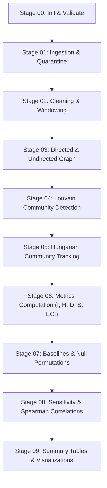

# Temporal Echo Chamber Detection in Online Social Networks

[](https://www.python.org/downloads/)
[](LICENSE-or-ATTRIBUTION.md)
[](tests/)

A reproducible research pipeline and interactive dashboard for quantifying **Boundary Isolation**, **Semantic Homogeneity**, and **External Exposure Scarcity** across dynamic social network communities.

---

## 🌟 Key Features

1. **Three-Factor Echo Chamber Index (ECI)**:
   - **Isolation $I(C, t)$**: Outgoing volume boundary closure $W_{\text{in}} / (W_{\text{in}} + W_{\text{out}})$.
   - **Homogeneity $H(C)$**: Scaled unit cosine similarity over 300D embeddings computed via an $O(m \cdot d)$ vector-sum identity.
   - **Exposure Scarcity $S(C, t)$**: Normalized Shannon entropy over external destination communities $S = 1 - D$.
2. **Deterministic & Seeded Pipeline**: Alphabetically sorted graph nodes, fixed Louvain resolution and seed, reproducible Hungarian bipartite community tracking across quarters.
3. **Statistical Rigor**: 7 baseline ablation models, embedding permutation null models ($z$-scores and empirical $p$-values), bootstrap confidence intervals, and Spearman rank correlations.
4. **Streamlit Multi-Page Research Dashboard**: Interactive exploration of network properties, community leaderboards, longitudinal trajectories, and ablation comparisons.
5. **Security & Data Integrity**: Protection against CSV formula injection (`=`, `+`, `-`, `@`) and atomic filesystem output writing.

---

## 🚀 Quickstart

### 1. Installation

```bash
# Clone or navigate to the repository
cd temporal-echo-chambers

# Create virtual environment with system packages
python -m venv .venv --system-site-packages
.\.venv\Scripts\Activate.ps1

# Install in editable mode
pip install -e . --no-build-isolation --no-deps
```

### 2. Run Fixture Pipeline (Deterministic Synthetic Test Data)

```bash
echochamber run --config configs/fixture.yaml
```

Outputs will be saved in `results/fixture-default/`:
- `metrics.parquet`, `communities.parquet`, `tracking.parquet`
- `baselines.parquet`, `null_model_results.parquet`, `sensitivity_resolution.parquet`
- `summary_tables/window_summary.csv`, `summary_tables/top_echo_chambers.md`
- `plots/*.png`, `plots/interactive_scatter.html`
- `manifest.json`

### 3. Launch Interactive Dashboard

```bash
streamlit run app/Home.py
```

### 4. Run Test Suite

```bash
pytest -v
```

---

## 📊 Pipeline Architecture (10 Stages)



---

## 📐 Exact Mathematical Formulations

- **Isolation**:
  $$I(C, t) = \frac{W_{\text{in}}}{W_{\text{in}} + W_{\text{out}}}$$
- **Homogeneity**:
  $$\text{avg\_cos} = \frac{\left\|\sum_{u=1}^m z_u\right\|^2 - m}{m(m - 1)}, \quad H(C) = \frac{\text{avg\_cos} + 1}{2}$$
- **External Diversity & Scarcity**:
  $$p_j = \frac{W(C \to C_j)}{W_{\text{out}}}, \quad E = -\sum_{j} p_j \ln(p_j), \quad D = \frac{E}{\ln(K_{\text{possible}})}, \quad S = 1 - D$$
- **Echo Chamber Index**:
  $$\text{ECI} = w_I \cdot I + w_H \cdot H + w_S \cdot S$$

---

## 📚 Documentation
- [Implementation Status & Test Verification](docs/IMPLEMENTATION_STATUS.md)
- [Mathematical Methods & Tracking](docs/METHODS.md)
- [Experimental Results](docs/RESULTS.md)
- [Data Dictionary & Parquet Schemas](docs/DATA_DICTIONARY.md)
- [Experiment Catalog](docs/EXPERIMENTS.md)
- [Limitations & Ethical Considerations](docs/LIMITATIONS.md)
- [Troubleshooting Guide](docs/TROUBLESHOOTING.md)
- [Reproducibility Protocol](docs/REPRODUCIBILITY.md)
